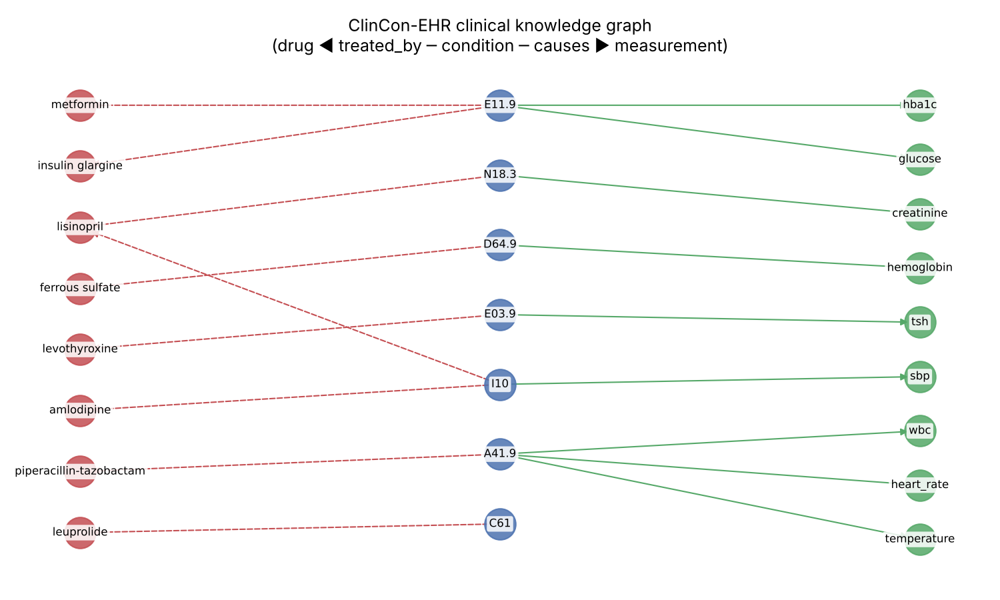
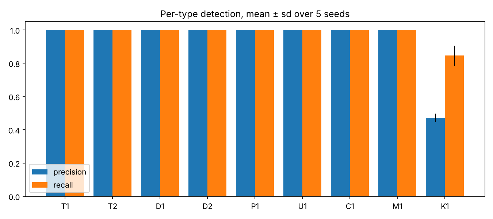

# ClinCon-EHR

**Interpretable rule-based and causal-graph detection of patient-level clinical inconsistencies in synthetic electronic health records.**

[](https://github.com/raiyanmuntasir/clincon-ehr/actions/workflows/ci.yml)


This repository contains the reference implementation that accompanies the manuscript in preparation:

> Monim, R. M., Talha, A., & Islam, K. *ClinCon-EHR: An interpretable rule-based and causal framework for detecting patient-level clinical inconsistencies in synthetic electronic health records.* (in preparation)

The code was written as an open, reproducible companion to the manuscript. The numbers below come from this code's synthetic benchmark; they are not the figures reported in the manuscript.

---

## Why this matters

Synthetic EHRs are increasingly used to share clinical data without exposing patients, and real EHRs are full of documentation errors. In both cases a record can look statistically normal while being clinically impossible: a delivery coded for a male patient, labs charted after the date of death, or an anaemia diagnosis with consistently high haemoglobin. Generic anomaly detectors miss these errors because they are *semantic*, not statistical.

ClinCon-EHR detects them with two complementary, fully explainable components:

1. **Deterministic clinical rules**: temporal, demographic, plausibility, unit, integrity and pharmacological checks.
2. **A causal knowledge graph**: `condition → physiological effect → measurement` and `condition → treatment`. A diagnosis whose expected downstream evidence points the *opposite* way is flagged.

Every finding is a plain-English sentence with the exact values that triggered it:

```
10001448 D1 high    O80 (Encounter for full-term uncomplicated delivery) is specific to sex F but patient is M.
10000037 U1 medium  Glucose 5.3 mg/dL is impossible in mg/dL but plausible in mmol/L (= 95 mg/dL); likely unit error.
10000065 T2 high    19 measurement(s) recorded after date of death 2023-02-09 (first: potassium at 2023-03-03 05:06).
10000008 K1 medium  D64.9 (Anemia, unspecified) is not supported by its causal evidence:
                    hemoglobin expected low, median 14.105 (ref 12-15.5, score -0.20, n=4).
```

## Inconsistency taxonomy

| ID | Category | What is checked |
|---|---|---|
| T1 | temporal | Discharge time precedes admission time |
| T2 | temporal | Clinical event recorded after date of death |
| D1 | demographic | Sex-specific diagnosis recorded for the other sex |
| D2 | demographic | Diagnosis outside its plausible age range |
| P1 | plausibility | Physiologically implausible measurement value |
| U1 | plausibility | Unit mismatch (e.g. glucose in mmol/L stored as mg/dL) |
| C1 | integrity | Conflicting duplicate measurements at the same timestamp |
| M1 | pharmacological | Disease-specific drug without a supporting diagnosis |
| K1 | causal | Diagnosis contradicted by its expected physiological evidence |

## Causal knowledge graph



For each diagnosis and each of its causal effects, the evidence score is

$$ s = \text{sign}\cdot\frac{\tilde v - \text{mid}}{\text{half-width}} $$

where $\tilde v$ is the median of the patient's plausible values for that measurement and the reference interval is sex-specific. $s = 1$ means the typical value is on the reference limit in the expected direction; $s < 0$ means it sits on the wrong side of the midpoint. A diagnosis is flagged (K1) when its best effect score is below a threshold (default 0). Values already flagged as implausible or unit errors are excluded first, so the rules and the causal check do not double-count.

This is a consistency test against curated clinical knowledge. It is not causal discovery or treatment-effect estimation.

## Benchmark

`clincon.generator` produces a synthetic cohort with a MIMIC-IV-inspired schema (`patients`, `admissions`, `diagnoses_icd`, `prescriptions`, `measurements`). Nine conditions, 12 labs and vitals, sex- and age-restricted diagnoses, treatments, deaths and multi-admission histories are included. The generated cohort is internally consistent. A realistic share of diagnosed patients (6%) have controlled or resolved labs, which are *not* errors.

`clincon.injector` then corrupts 20% of patients, one error per patient, and logs the ground truth.

**Results:** 2,000 patients per run, 5 random seeds, mean ± sd. Reproduce with `python -m clincon`.

| Method (patient level) | Precision | Recall | F1 |
|---|---|---|---|
| **ClinCon-EHR** (rules + causal graph) | **0.923 ± 0.007** | **0.983 ± 0.007** | **0.952** |
| Isolation Forest on aggregate patient features | 0.275 ± 0.022 | 0.275 ± 0.022 | 0.275 |



**How to read these numbers:**

* The eight rule-based types (T1–M1) reach 1.0 precision and recall. That is expected, because each rule encodes exactly the constraint the injector violates. These results show the rules are correctly implemented and do not fire on clean data. They do not predict performance on real-world records.
* **The causal check (K1) is the hard, open part of the problem:** precision 0.47 ± 0.03, recall 0.85 ± 0.06 at threshold 0. Most false positives are the controlled or resolved patients, whose diagnosis is correct but whose labs have normalised. Separating "wrong diagnosis" from "successfully treated diagnosis" needs temporal and medication reasoning, which is the main direction for future work. The threshold trades precision against recall (`results/causal_threshold_sweep.png`).
* On the un-injected cohort, ClinCon-EHR flags 39–47 of 2,000 patients (about 2%), all through K1.
* Isolation Forest is given the true contamination rate and still finds only about 27% of corrupted patients. Clinical inconsistencies rarely make a record an outlier.

Full tables: [`results/RESULTS.md`](results/RESULTS.md).

## Quick start

```bash
git clone https://github.com/raiyanmuntasir/clincon-ehr.git
cd clincon-ehr
pip install -r requirements.txt

python -m clincon                     # full 5-seed benchmark -> results/
python -m clincon --seeds 42 --save-data   # single run, also export synthetic EHR CSVs
python -m unittest discover -s tests -t .  # tests
```

Use it on your own tables, as long as they follow the same column names:

```python
from clincon.generator import EHR
from clincon.evaluate import detect

ehr = EHR(patients=..., admissions=..., diagnoses_icd=..., prescriptions=..., measurements=...)
findings = detect(ehr)          # pandas DataFrame: subject_id, rule, category, severity, message, hadm_id
```

## Repository layout

```
clincon/
  knowledge.py     reference ranges, ICD-10 conditions, effects, treatments (single source of clinical knowledge)
  generator.py     synthetic EHR generator (MIMIC-IV-style schema)
  injector.py      controlled inconsistency injection with ground-truth log
  rules.py         deterministic, explainable rules (T1-M1)
  causal_graph.py  causal knowledge graph and evidence scoring (K1)
  evaluate.py      detection pipeline, Isolation Forest baseline, metrics
  cli.py           end-to-end benchmark, figures and RESULTS.md
tests/             unit tests
results/           benchmark outputs committed for reference
```

## Limitations

* Every record is synthetic. No real patient data is used or distributed, and no claim is made about performance on real EHRs.
* The generator and the detectors share one knowledge base, so the rule-based results are an upper bound by construction. The causal check uses only reference intervals and effect directions, not the generator's distributions.
* Reference ranges are typical adult values chosen for illustration. This software is not a medical device and must not be used for clinical decisions.

## Citation

If you use this code, please cite the manuscript (citation will be updated on publication):

```bibtex
@unpublished{monim_clincon_ehr,
  author = {Monim, Raiyan Muntasir and Talha, A. and Islam, K.},
  title  = {ClinCon-EHR: An interpretable rule-based and causal framework for detecting
            patient-level clinical inconsistencies in synthetic electronic health records},
  note   = {Manuscript in preparation}
}
```
